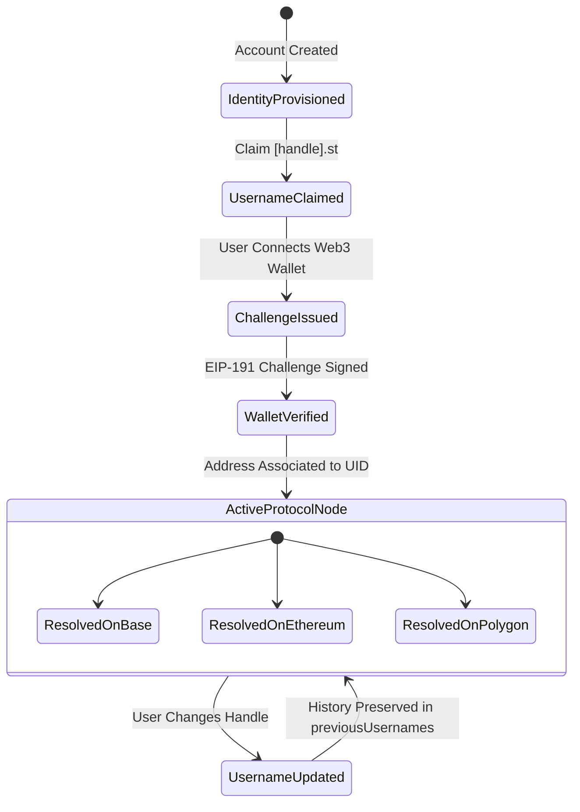

# ST ID Protocol Specification (v0.1)

> **ST (Supertime) Universal Identity & Self-Custody Wallet Resolution Protocol**

---

## 1. Overview & Core Philosophy

The **ST ID Protocol** is an open-source, non-custodial identity and name-resolution standard built on the principle that **Time is the fundamental human asset**. 

Traditional identity architectures either force users into centralized silos (OAuth / Web2 databases) or impose punitive friction and high gas fees (deploying smart contracts for every user on Layer 1 blockchains).

ST ID solves this through a layered, modular protocol:
1. **Permanent Unique Identifier (UID):** Non-sequential, globally unique, immutable, independent of username and email.
2. **Human-Readable Namespace (`.st`):** e.g., `aman.st` mapping to human presence and verified cryptographic addresses.
3. **Multi-Wallet Non-Custodial Ownership:** Verified through cryptographic challenges (EIP-191 / EIP-4361).
4. **Universal Resolver:** Translates `name.st + network` into a verified on-chain receiving address with a **Zero-Substitution Guarantee**.
5. **Zero Private Key Custody:** The protocol never stores, receives, derives, or manages private keys.

---

## 2. Identity Model & Lifecycle



### 2.1 The Permanent UID (`st_uid_...`)
* **Format:** `st_uid_[24-char-hex]`
* **Generation:** Generated via cryptographically secure pseudo-random number generator (`crypto.randomBytes(12)`).
* **Immutability:** Once minted, a UID is never altered, transferred, or deleted. It persists across email changes and handle renames.
* **Separation of Concerns:** The UID does not encode the user's name, email, or wallet address, preventing correlation attacks.

### 2.2 The `.st` Human-Readable Namespace
* **Canonical Form:** `[base].st` where `base` is 3 to 30 lowercase alphanumeric characters with hyphens and underscores.
* **Reserved Namespaces:** Protocol infrastructure, routing nodes, and sensitive keywords (`admin`, `supertime`, `protocol`, `system`, `operator`, `monkey`, `vault`, etc.) cannot be claimed by standard users.
* **History Preservation:** When an identity changes its `.st` handle, the prior name is appended to `previousUsernames`. Former names enter a cooldown to prevent identity impersonation.

---

## 3. Data Schema & Redis Model

```typescript
export interface STIdentity {
  uid: string;                 // "st_uid_6abf854a..."
  currentUsername: string;     // "aman.st"
  previousUsernames: string[]; // ["oldhandle.st"]
  createdAt: number;
  updatedAt: number;
  status: 'active' | 'suspended';
  profileRef: {
    email: string;
    displayName?: string;
  };
  publicKeys: STPublicKey[];
  wallets: STAssociatedWallet[];
}

export interface STAssociatedWallet {
  id: string;                  // "w_evm_0x741cd4..."
  networkType: 'evm' | 'bitcoin' | 'solana';
  address: string;             // Checksummed address
  supportedChains: string[];   // ["ethereum", "base", "polygon", "arbitrum", "optimism"]
  isPrimary: boolean;
  verifiedAt: number;
  ownershipProof: {
    type: 'eip191_signature';
    message: string;
    signature: string;
    nonce: string;
  };
}
```

### Storage Conventions:
* `st_identity:{uid}` $\to$ JSON entity
* `st_name:{name.st}` $\to$ `uid` pointer
* `st_user_identity:{email}` $\to$ `uid` pointer
* `st_identity_events:{uid}` $\to$ Append-only audit log of events
* `st_challenge:{nonce}` $\to$ Ephemeral verification challenge (TTL: 300s)

---

## 4. Cryptographic Wallet Verification (EIP-191)

ST ID uses a zero-custody, challenge-response protocol:

1. **Challenge Generation (`/api/st/wallet/challenge`):**
   * Server generates a random 16-byte hex nonce stored in KV with a 300-second TTL.
   * Formats a human-readable message following EIP-191 / EIP-4361:
     ```
     supertime.wtf wants you to sign in with your Ethereum account:
     0x741Cd4DabFc802Db4167B4fc272E12b0a0181F12

     Bind wallet to ST Identity:
     Permanent UID: st_uid_6abf854a77232b0f688409d0
     Username: aman.st

     URI: https://supertime.wtf
     Version: 1
     Nonce: a8f419c83b2e7d10
     Issued At: 2026-11-20T04:00:00.000Z
     Expiration Time: 2026-11-20T04:05:00.000Z
     ```
2. **Client Signing:**
   * The user signs the challenge using their self-custody wallet (`personal_sign`).
   * No gas is consumed.
3. **Server Verification & Nonce Burn (`/api/st/wallet/verify`):**
   * Server verifies the signature using `viem.verifyMessage`.
   * The nonce is immediately burned to prevent signature replay attacks.
   * The checksummed address is appended to `identity.wallets`.

---

## 5. The Universal Name Resolver

The resolver maps any `.st` handle to a chain-specific receiving address.

* **Signature:** `resolveSTName(name, network)`
* **The Zero-Substitution Guarantee:**
  * If a user has an EVM wallet registered, queries for `base`, `ethereum`, and `polygon` resolve cleanly.
  * If a user does **not** have a Bitcoin or Solana address registered, a query for `bitcoin` or `solana` returns `NO_WALLET_FOR_NETWORK`.
  * **The protocol NEVER silently substitutes an address from a different network.**

---

## 6. Supported Networks Matrix

| Network | ID | Type | Chain ID | Status |
| :--- | :--- | :--- | :--- | :--- |
| **Base** | `base` | EVM | 8453 | ✅ Supported (Default L2) |
| **Ethereum** | `ethereum` | EVM | 1 | ✅ Supported |
| **Polygon PoS** | `polygon` | EVM | 137 | ✅ Supported |
| **Arbitrum One** | `arbitrum` | EVM | 42161 | ✅ Supported |
| **OP Mainnet** | `optimism` | EVM | 10 | ✅ Supported |
| **Bitcoin** | `bitcoin` | UTXO | — | 🟡 Adapter in Scope |
| **Solana** | `solana` | SVM | — | 🟡 Adapter in Scope |

---

## 7. Future Decentralization Roadmap

1. **Phase 1 (Current):** Federated protocol registry hosted in open-source Next.js + Redis KV with cryptographic EIP-191 proofs.
2. **Phase 2 (Cross-Chain Attestations):** Minting ST ID attestations via EAS (Ethereum Attestation Service) on Base for decentralized on-chain verifiability.
3. **Phase 3 (Account Abstraction & ERC-4337):** Optional smart accounts with session keys for micro-time payments, sponsored gas, and passkey recovery.
4. **Phase 4 (L3 / AppChain Time Sovereign):** Native time-minting registry where creative hours are backed by sovereign cryptographic validation.
